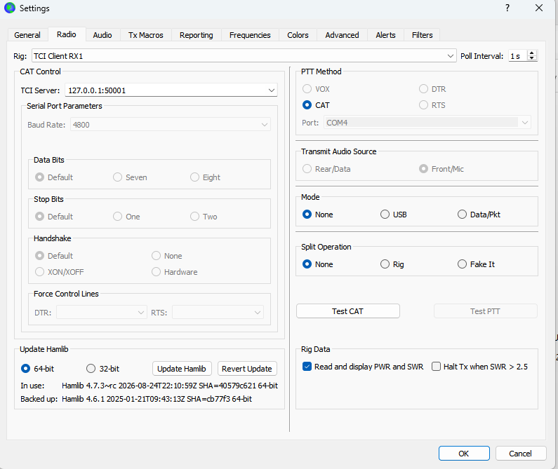
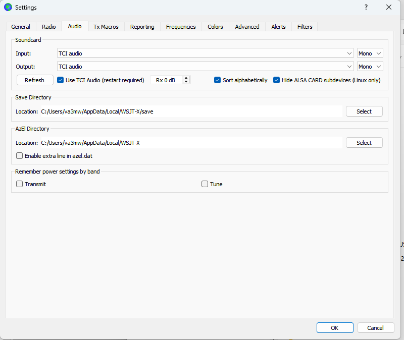

# FlexTCI

A TCI (Transceiver Control Interface) server for FlexRadio on Windows. TCI clients such as WSJT-X connect over a WebSocket on localhost. FlexTCI controls the slice through the SmartSDR TCP API. It takes the audio **directly from the radio** as VITA-49 DAX streams over UDP, so neither SmartSDR DAX nor the Windows DAX sound devices are needed. It is the "one connection instead of CAT + DAX" setup from the TCI requirements draft (v0.1), built as a standalone bridge.


## How it works

```
WSJT-X ──ws://127.0.0.1:50001──┐                      ┌── TCP 4992 ── radio API (slice A: freq, mode, PTT…)
WSJT-X ──ws://127.0.0.1:50002──┤  FlexTCI (one port  ├── UDP  ◄──── dax_rx stream per channel (VITA-49)
Log4OM ──ws://127.0.0.1:50001──┘   per slice)         └── UDP  ────► dax_tx stream (whoever is keyed)
```

**Audio** comes straight from the radio. FlexTCI registers a UDP port with `client udpport` and opens a `dax_rx` stream for each channel's DAX channel. It opens a `dax_tx` stream for transmit, taking DAX TX ownership with `stream set … tx=1`. RX arrives as float32 stereo at the slice's `sample_rate` (24 kHz on a 6600M) and is resampled to whatever the TCI client asked for. TX goes out in 128-frame packets paced to the TX slice's rate. The streams are recreated after a reconnect. Windows Firewall must allow FlexTCI to receive UDP. Each channel has an RX gain (default −40 dB, which puts WSJT-X near 30 dB), and there is one TX gain.

* **One TCI port per slice.** Each channel is a port, a slice letter, a DAX channel and an RX gain. The defaults are Slice A → port 50001 → DAX 1, Slice B → 50002 → DAX 2, and so on. Each WSJT-X or JTDX instance uses **TCI Client RX1** on its own port. A client set to RX2 also works: every receiver index on a port maps to that port's slice.
* You can run 1 to 8 channels (the default is 1). Several clients can share a port (for example WSJT-X and a logger on the same slice), and they are kept in sync.
* SmartSDR (or another GUI station) must be running, because it owns the slices. SmartSDR DAX is not needed. FlexTCI binds to the station you pick, so in multiFLEX "Slice A" means *that station's* Slice A.
* When a client connects, the slice's DAX channel is set to match its assignment. You can turn this off with **Set slice DAX channel**.

## WSJT-X setup

1. **Settings → Radio:** Rig **TCI Client RX1**, TCI Server `127.0.0.1:50001` (the channel's port). PTT method **CAT**. Mode **None** (FlexTCI switches USB/LSB to DIGU/DIGL itself when transmitting). Split operation **None** or **Fake It** (TCI split is not mapped yet).

   

2. **Settings → Audio:** tick **Use TCI Audio (restart required)**, set Input and Output to **TCI audio**, then restart WSJT-X. Set the receive level with FlexTCI's **RX dB** for the channel (aim for about 30 dB on the WSJT-X meter) rather than WSJT-X's Rx gain.

   

**Known WSJT-X issue (seen in WSJT-X improved 3.0.0 and 3.0.2):** at start-up WSJT-X may show **Rig Control Error**, with the detail *TCI audio cannot be started as frequency is OOB*. It happens even when the slice is on a normal frequency.

The cause is a timing race inside WSJT-X improved:
- After opening the TCI connection, WSJT-X waits a fixed 2 s, plus 0.5 s for audio, before it passes the radio's frequency to its main window (`Transceiver/TCITransceiver.cpp`). FlexTCI sends the frequency the moment WSJT-X connects, but no TCI message ends that wait early.
- Meanwhile WSJT-X checks its band box on a 5 s start-up timer and again when Monitor turns on (`widgets/mainwindow.cpp`). If no frequency has arrived yet, the band box reads "OOB" and the check fails.
- The first failure triggers a silent retry. The retry does not reconnect, so the second check fails too and shows the dialog.

FlexTCI cannot fix this from the server side. To recover, open WSJT-X **Settings** and close it with **OK**. WSJT-X reconnects, the frequency is known by then, and it works normally.

For more slices, run one WSJT-X instance per channel (`wsjtx --rig-name=SliceB`) and point each at its own port (50002, 50003, …).

## Transmit safety

* Only one TCI client can transmit at a time. A second client trying to key is refused, and the refusal is logged.
* The radio unkeys if the transmitting client **disconnects or crashes**. Dead links are caught by WebSocket ping, with a 10 s read timeout.
* If the client keyed with TCI audio (`TRX:0,true,tci`), the radio also unkeys when the client **stops sending TX audio** for the safety timeout (default 2000 ms). It unkeys too if the **DAX TX stream to the radio stalls**, and that case is logged separately.
* `TX_ENABLE` follows the radio's interlock `tx_allowed` and `transmit inhibit`. Keying is refused while it is false.
* `TRX` reports true only while the bound station's transmitter is keyed (interlock `tx_client_handle`), so another multiFLEX station transmitting does not show up as this client's TX.
* Any TCI client may unkey TCI transmit. Transmit started in SmartSDR (MOX, mic PTT) is never unkeyed by a client's `TRX:false`.
* When a client transmits its own (TCI) audio, a slice left in **USB/LSB is switched to DIGU/DIGL**, and **TX DAX is turned on** if it was off. Without DAX the client's audio never reaches the transmitter. Both changes happen before keying, are logged as warnings, and are left in place. You can turn this off in Settings. FlexTCI then only switches DAX on for the duration of the transmission.

## Security

TCI has no authentication, so FlexTCI limits who can reach it:
* TCI ports listen on loopback only (`127.0.0.1` and `[::1]`), never on the LAN.
* **Web pages are refused.** A browser can open `ws://127.0.0.1:…` from any site you visit, so connections that carry a non-localhost `Origin` header get HTTP 403 and are logged. Native clients send no `Origin` header and are not affected.
* Audio UDP packets are accepted only from the radio's IP address.
* Client input is bounded: audio sample rates must be TCI rates, frames are capped at 1 MB, and logged frames and the ignored-command list have size limits.
* The Go toolchain is pinned in `go.mod` to a release with no known reachable vulnerabilities (`govulncheck ./...`).

## Logging

The log window filters by level (Traffic, Debug, Info, Warnings, Errors) and by text. **Capture TCI/API traffic** records every TCI line in each direction (`#n <-`, `#n ->`) and every radio API command and status. Logs are also written daily to `%APPDATA%\FlexTCI\logs\` (the **Open log folder** button). Each unkey line carries a TX summary, for example `keyed 12.6 s, 590 TX_CHRONO sent, 590 audio blocks received`.

## TCI coverage (phase 1)

| Area | Commands |
|---|---|
| Init burst | `protocol`, `device`, `receive_only`, `trx_count:2` (both indices map to the port's slice, so RX1 and RX2 client settings work), `channel_count:2`, `vfo_limits`, `if_limits`, `modulations_list`, full state, `start`, `ready` |
| Tuning | `vfo` (A sets; B echoes A), `dds`/`if` (read-only), `modulation`, `rx_filter_band`, `rit_*`, `xit_*` |
| TX | `trx` (incl. `tci` source), `tune`, `drive`, `tune_drive`, `tx_enable` |
| Audio | `audio_start/stop`, `audio_samplerate` 8/12/24/48 kHz, `audio_stream_sample_type`, `audio_stream_channels`, `audio_stream_samples`, `tx_stream_audio_buffering`, TX_CHRONO pull model |
| Spots | `spot`, `spot_delete`, `spot_clear` (in), `clicked_on_spot` (out) |
| Ignored (logged once) | CW macros/keyer, volume/mute, NB/NR/ANF, sensors, IQ, line-out, and anything unknown |

Set commands are echoed to every client right away (WSJT-X waits for this). The value is then held until the radio confirms it, which stops stale radio status from making the value bounce.

Spots: `SPOT:callsign,mode,freqHz,ARGB,text;` becomes a panadapter spot (`spot add`, source `FlexTCI`) that the radio expires after 15 minutes. A callsign has one spot, so sending it again moves it. `SPOT_DELETE` and `SPOT_CLEAR` remove only spots that FlexTCI added (`spot remove <index>`, never `spot clear`), so cluster or N1MM spots are left alone. Clicking a TCI spot in SmartSDR sends `clicked_on_spot:callsign,freqHz;` to every TCI client. **Show TCI spots on the panadapter** in Settings turns all of this off.

Modes: `modulations_list` is built from the slice's `mode_list` as reported by the radio. A FLEX-6600M without waveforms gives `lsb,usb,am,cw,digl,digu,sam,nfm,dfm,rtty`. The mapping is Flex FM/NFM↔`nfm` and FDV↔`freedv`. `DEVICE` reports the model from the radio's `info` reply.

Each port listens on both `127.0.0.1` and `[::1]`, so `localhost` works in clients that resolve it to IPv6.

## Install and updates

FlexTCI is a single exe with no installer. To keep it in one place:

- **Settings > Install in AppData** copies the running exe to `%APPDATA%\FlexTCI\FlexTCI.exe` (the folder that already holds the settings and logs), creates a desktop shortcut and restarts from there. TCI clients reconnect.
- **Settings > Desktop shortcut** only adds a shortcut to the exe that is running.
- **Settings > Check for updates** compares the running version with the [latest GitHub release](https://github.com/va3mw/FlexTCI/releases/latest). If a newer one exists it asks, then downloads it next to the running exe, checks it against the SHA-256 GitHub published, swaps it in and restarts. The previous exe stays as `FlexTCI.exe.old` until the next start.

FlexTCI also checks once at start-up and notes an available update in the log; it never installs without asking. Update checks only work while the repository is public: GitHub answers 404 for a private one, and FlexTCI reports "no public release found".

**Releasing:** bump `version` in `main.go` and `productVersion` in `wails.json`, build, then create a GitHub release tagged `v<version>` with the exe attached as `FlexTCI-<version>.exe`. GitHub records the asset's SHA-256, which the updater checks.

## Build and test

```bash
wails build            # -> build/bin/FlexTCI.exe (no C compiler needed)
go test ./...          # includes end-to-end tests against a fake radio (TCP API + VITA-49 UDP)
```

Settings are stored in `%APPDATA%\FlexTCI\config.json`.

## Layout

```
main.go, app.go          Wails app and UI bindings
app_install.go           Install, shortcut and update actions (install.go, update.go, shortcut_windows.go)
frontend/dist/index.html UI (plain HTML/JS, no npm)
internal/flex            radio discovery (UDP 4992) and SmartSDR TCP API client
internal/vita            VITA-49 DAX audio packets (parse/build)
internal/audio           resampler and TX FIFO
internal/tci             TCI text/binary protocol, sample formats, mode map
internal/bridge          channels, clients, direct RX/TX streams, view diffing, TX arbitration and safety
internal/logx, config    logging and persisted settings
```

## Not done yet / open items

* Split (VFO B to TX frequency), CW macros, meters/sensors, IQ, and SmartLink are deferred, as are other phase 2/3 items in the requirements draft.
* The TX gain trim is a simple software gain. The level that gives full rated power (OI-15) still has to be measured.
* `PROTOCOL` reports `ExpertSDR3,2.0` by default for client compatibility (OI-23). You can change it in the UI.
* Tested on a FLEX-6600M: WSJT-X 3.0 and JTDX, each on its own port and slice, with JTDX set as TCI Client RX2. MSHV and Log4OM are still to be tested. Use the traffic log to capture sessions.
