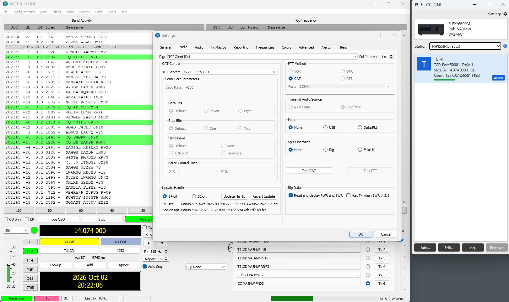

# FlexTCI

A TCI (Transceiver Control Interface) server for FlexRadio on Windows. TCI clients such as WSJT-X connect over a WebSocket on localhost. FlexTCI controls the slice through the SmartSDR TCP API. It takes the audio **directly from the radio** as VITA-49 DAX streams over UDP, so neither SmartSDR DAX nor the Windows DAX sound devices are needed. It is the "one connection instead of CAT + DAX" setup from the TCI requirements draft (v0.1), built as a standalone bridge.



## How it works

```
WSJT-X ──ws://127.0.0.1:50001──┐                      ┌── TCP 4992 ── radio API (slice A: freq, mode, PTT…)
WSJT-X ──ws://127.0.0.1:50002──┤  FlexTCI (one port  ├── UDP  ◄──── dax_rx stream per channel (VITA-49)
Log4OM ──ws://127.0.0.1:50001──┘   per slice)         └── UDP  ────► dax_tx stream (whoever is keyed)
```

**Audio path** (in Options):
* **Direct from radio** (default). FlexTCI registers a UDP port with `client udpport` and opens a `dax_rx` stream for each channel's DAX channel. It opens a `dax_tx` stream for transmit, taking DAX TX ownership with `stream set … tx=1`. RX arrives as float32 stereo at the slice's `sample_rate` (24 kHz on a 6600M) and is resampled to whatever the TCI client asked for. TX goes out in 128-frame packets paced to the TX slice's rate. The streams are recreated after a reconnect. Windows Firewall must allow FlexTCI to receive UDP.
* **Windows DAX devices**. This is the original path through SmartSDR DAX's "DAX Audio RX n" / "DAX Audio TX" sound devices, kept as a fallback.

* **One TCI port per slice.** Each channel is a port, a slice letter, a DAX channel and a DAX RX device. The defaults are Slice A → port 50001 → DAX 1, Slice B → 50002 → DAX 2, and so on. Every client sees a single transceiver (`trx 0`), so each WSJT-X instance uses **TCI Client RX1** on its own port.
* You can run 1 to 8 channels (the default is 1). Several clients can share a port (for example WSJT-X and a logger on the same slice), and they are kept in sync.
* SmartSDR (or another GUI station) must be running, because it owns the slices. SmartSDR DAX is only needed for the Windows audio path. FlexTCI binds to the station you pick, so in multiFLEX "Slice A" means *that station's* Slice A.
* When a client connects, the slice's DAX channel is set to match its assignment. You can turn this off with **Set slice DAX channel**.

## WSJT-X setup

1. Settings → Radio: Rig **TCI Client RX1**, Network server `127.0.0.1:50001` (the channel's port).
2. PTT method **CAT**. Split operation **None** or **Fake It** (TCI split is not mapped yet).
3. Settings → Audio: choose the **TCI audio** input and output.

## Transmit safety

* Only one TCI client can transmit at a time. A second client trying to key is refused, and the refusal is logged.
* The radio unkeys if the transmitting client **disconnects or crashes**. Dead links are caught by WebSocket ping, with a 10 s read timeout.
* If the client keyed with TCI audio (`TRX:0,true,tci`), the radio also unkeys when the client **stops sending TX audio** for the safety timeout (default 2000 ms). It unkeys too if the **DAX TX device stops consuming audio**, and that case is logged separately.
* `TX_ENABLE` follows the radio's interlock `tx_allowed` and `transmit inhibit`. Keying is refused while it is false.
* `TRX` reports true only while the bound station's transmitter is keyed (interlock `tx_client_handle`), so another multiFLEX station transmitting does not show up as this client's TX.
* Any TCI client may unkey TCI transmit. Transmit started in SmartSDR (MOX, mic PTT) is never unkeyed by a client's `TRX:false`.
* If the slice is in a non-digital mode while TCI audio transmits, the TX audio source is switched to DAX for the duration and then restored.

## Logging

The log window filters by level (Traffic, Debug, Info, Warnings, Errors) and by text. **Capture TCI/API traffic** records every TCI line in each direction (`#n <-`, `#n ->`) and every radio API command and status. Logs are also written daily to `%APPDATA%\FlexTCI\logs\` (the **Open log folder** button). Each unkey line carries a TX summary, for example `keyed 12.6 s, 590 TX_CHRONO sent, 590 audio blocks received`.

## TCI coverage (phase 1)

| Area | Commands |
|---|---|
| Init burst | `protocol`, `device`, `receive_only`, `trx_count:1`, `channel_count:2`, `vfo_limits`, `if_limits`, `modulations_list`, full state, `start`, `ready` |
| Tuning | `vfo` (A sets; B echoes A), `dds`/`if` (read-only), `modulation`, `rx_filter_band`, `rit_*`, `xit_*` |
| TX | `trx` (incl. `tci` source), `tune`, `drive`, `tune_drive`, `tx_enable` |
| Audio | `audio_start/stop`, `audio_samplerate` 8/12/24/48 kHz, `audio_stream_sample_type`, `audio_stream_channels`, `audio_stream_samples`, `tx_stream_audio_buffering`, TX_CHRONO pull model |
| Ignored (logged once) | spots, CW macros/keyer, volume/mute, NB/NR/ANF, sensors, IQ, line-out, and anything unknown |

Set commands are echoed to every client right away (WSJT-X waits for this). The value is then held until the radio confirms it, which stops stale radio status from making the value bounce.

Modes: `modulations_list` is built from the slice's `mode_list` as reported by the radio. A FLEX-6600M without waveforms gives `lsb,usb,am,cw,digl,digu,sam,nfm,dfm,rtty`. The mapping is Flex FM/NFM↔`nfm` and FDV↔`freedv`. `DEVICE` reports the model from the radio's `info` reply.

Each port listens on both `127.0.0.1` and `[::1]`, so `localhost` works in clients that resolve it to IPv6.

## Build and test

```bash
wails build            # -> build/bin/FlexTCI.exe (no C compiler needed; WASAPI is pure Go)
go test ./...          # includes an end-to-end test against a fake radio
go run ./cmd/audiotest -dax 1   # checks the DAX devices on this PC without keying anything
```

Settings are stored in `%APPDATA%\FlexTCI\config.json`.

## Layout

```
main.go, app.go          Wails app and UI bindings
frontend/dist/index.html UI (plain HTML/JS, no npm)
internal/flex            radio discovery (UDP 4992) and SmartSDR TCP API client
internal/vita            VITA-49 DAX audio packets (parse/build)
internal/audio           WASAPI capture/render (go-wca, fallback path), resampler, FIFO
internal/tci             TCI text/binary protocol, sample formats, mode map
internal/bridge          channels, clients, view diffing, TX arbitration and safety
internal/logx, config    logging and persisted settings
cmd/audiotest            audio device diagnostic
```

## Not done yet / open items

* Split (VFO B to TX frequency), spots, CW macros, meters/sensors, IQ, and SmartLink are deferred, as are other phase 2/3 items in the requirements draft.
* There is no TX gain trim (OI-15). Output level is whatever the client sends into DAX TX.
* `PROTOCOL` reports `ExpertSDR3,2.0` by default for client compatibility (OI-23). You can change it in the UI.
* WSJT-X, MSHV and Log4OM have not been tested against a live radio yet. Use the traffic log to capture sessions.
