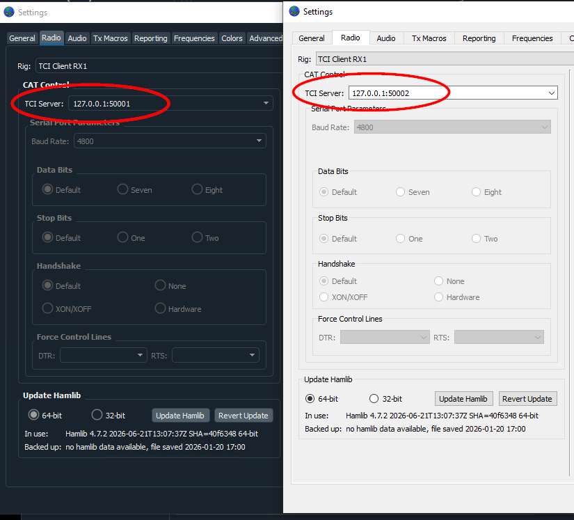

# Detailed instructions for multiple WSJT-X copies

With SliceTCI 0.6.5 or later you can run one WSJT-X per slice, each with its own desktop shortcut, in about five minutes. SliceTCI is a free TCI server for FlexRadio: each WSJT-X talks to its own slice over one connection that carries both control and audio. SmartSDR DAX and the DAX sound devices are not needed.

## What you need

- A FlexRadio with SmartSDR running on the same PC. The number of slices sets how many copies you can run: 2, 4 or 8 depending on the model (a FLEX-6600 has 4).
- WSJT-X 3.0 or later (it has TCI built in), installed the normal way (usually in `C:\WSJT\wsjtx`).
- Windows 10 or 11.
- About five minutes.

## Step 1: Get SliceTCI

1. **New users:** download `SliceTCI-<version>.exe` from the [latest release](https://github.com/va3mw/SliceTCI/releases/latest) and double-click it. It is a single program with no installer.
2. **Already using SliceTCI:** open **Settings** and click **Check for updates**. SliceTCI downloads the new version, checks it and restarts.
3. When Windows Firewall asks, click **Allow**. Radio audio arrives over the network, so SliceTCI must be allowed to receive it.
4. Optional but recommended: in **Settings**, click **Install to Program Files**. Windows asks for permission once. SliceTCI then lives in `C:\Program Files\SliceTCI` with a desktop shortcut, and later updates go there too.

Windows may say "Unknown publisher" because the program is not code-signed. That is expected.

## Step 2: Connect to the radio and add a channel per slice

Each WSJT-X copy needs its own SliceTCI channel. A channel is one slice, one TCI port and one DAX stream.

1. Start SmartSDR and open the slices you want to use (for example A and B).
2. In SliceTCI, open **Settings**, pick your radio under **Radio** and click **Connect**. SliceTCI remembers it next time.
3. You start with one channel: Slice A on port 50001.
4. Click **Add...** once for each extra slice. SliceTCI picks the next free slice, port and DAX channel for you:

| Slice | TCI port | DAX channel | Shortcut it gets |
| --- | --- | --- | --- |
| A | 50001 | 1 | WSJT-X A TCI |
| B | 50002 | 2 | WSJT-X B TCI |
| C | 50003 | 3 | WSJT-X C TCI |
| D | 50004 | 4 | WSJT-X D TCI |

The **Add...** button greys out when you reach your radio's slice count.

## Step 3: Create the WSJT-X shortcuts

One click puts a WSJT-X shortcut on your desktop for every channel.

1. Close any WSJT-X windows that are open.
2. In SliceTCI, open **Settings**.
3. Under **WSJT-X**, click **Desktop shortcuts**.
4. SliceTCI looks for WSJT-X on its own. If it cannot find it, or you have more than one copy installed, a window opens: browse to `wsjtx.exe` (usually `C:\WSJT\wsjtx\bin\wsjtx.exe`) and click **Open**. It remembers your choice; **Find...** changes it later.
5. A summary appears listing what it did. Click **OK**.

You now have one icon per channel on the desktop: **WSJT-X A TCI**, **WSJT-X B TCI**, and so on.

What the button does for each channel:

- Makes a shortcut that starts `wsjtx.exe --rig-name=SliceA-TCI` (SliceB-TCI for Slice B, and so on). The rig name gives each copy its own settings, log and window, so they can all run at once.
- If that copy has never been started, it prepares its settings for TCI: Rig **TCI Client RX1**, TCI Server **127.0.0.1** plus the channel's port, **TCI audio**, PTT **CAT**, and Mode and Split **None**. Your callsign, grid and other preferences are copied from your normal WSJT-X.
- If that copy already has settings, it leaves them alone. If its TCI Server points at the wrong port, the summary tells you.

Added a channel later? Click **Desktop shortcuts** again; it adds the new shortcut and leaves the others as they are.

## Step 4: Start each copy and check it

1. Double-click **WSJT-X A TCI**, then **WSJT-X B TCI**, and so on. Each opens its own WSJT-X window; the window title shows its rig name.
2. In each window, open **File > Settings > Radio** and check that **Rig** is **TCI Client RX1** and **TCI Server** shows that slice's port (A = 127.0.0.1:50001, B = 127.0.0.1:50002, and so on). Every copy must use a different port.
3. In **File > Settings > Audio**, check that **Use TCI Audio** is ticked and Input and Output say **TCI audio**. If you change this, restart that copy.
4. Look at SliceTCI: each channel now lists its WSJT-X under **Client**, and a blue **Audio** tag shows audio is flowing.
5. Change frequency in WSJT-X and watch the matching slice move in SmartSDR. That confirms each copy controls its own slice.

If a copy already had settings from before, steps 2 and 3 are where you fix them by hand.

Two copies set up correctly: each points at its own SliceTCI port.

## Step 5: Set the receive level

Set each channel's level in SliceTCI, not in WSJT-X, and aim for about 30 dB on the WSJT-X level meter.

1. In SliceTCI, select a channel and click **Edit...**.
2. Move the **RX gain** slider while you watch the level meter in the bottom left of that WSJT-X window. The change is heard at once.
3. Click **OK** to keep it, then repeat for the other channels.

The default RX gain is 0 dB, the same level DAX gives at its default slider of 50. Transmit level is the one **TX Audio Gain** slider on the main window, shared by all channels (default −6 dB, the same as DAX TX at 50).

## Troubleshooting

| What you see | What to do |
| --- | --- |
| WSJT-X shows a rig error and the band box reads "OOB" right after starting | Click **Retry**, or open **Settings** and close it with **OK**. WSJT-X checked the band before the frequency arrived; it works normally after that. |
| A channel shows **Not Present** | That slice is not open in SmartSDR. Open it, or edit the channel to use a slice that is open. |
| A channel shows **Port In Use** | Another program already uses that port. Edit the channel to use a different port, then click **Desktop shortcuts** again. |
| The summary says a copy uses the wrong port | Open that copy's **File > Settings > Radio** and set **TCI Server** to the port shown. |
| No decodes and the meter stays at 0 | Check that Windows Firewall allows SliceTCI, and that **Use TCI Audio** is ticked in that copy. |
| Two copies follow the same slice | Both use the same TCI port. Give each copy its own port in **Settings > Radio**. |

## Good to know

- If you make shortcuts by hand, type `--rig-name` with **two** dashes. With one dash, WSJT-X quietly creates a copy named "ig-name=..." with blank settings.
- Old hand-made shortcuts keep working. Delete any you no longer need, especially ones still set up for DAX.
- Each copy keeps its settings in its own folder, for example `%LOCALAPPDATA%\WSJT-X - SliceA-TCI`. Your normal WSJT-X is not changed.
- Several programs can share one channel, for example WSJT-X and a logger on Slice A, as long as they use the same port.
- Over a VPN or the internet, expect some lost audio and fewer decodes. That is the nature of network audio, not a fault.
- SmartLink is not supported yet; SliceTCI needs the radio on the local network or a VPN.

More detail is in the [README](README.md). SliceTCI is free and open source (MIT) and is not a product of FlexRadio Systems.
